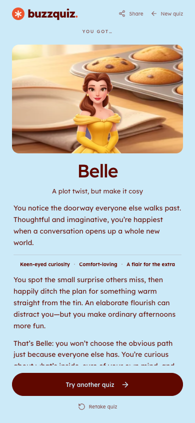

# buzzquiz

**Find out which Disney princess you are, based on your snack choices.**

Two blanks. Five questions. A personality reveal that's a little too specific.

[Take a quiz](https://buzzquiz.ryankuah.com) · [How it works](docs/architecture.md) · [Run it yourself](docs/development.md)

Buzzquiz brings back the joy of internet personality quizzes. Pick what you want to discover about yourself and what the questions should be about, then jump straight in. No account, quiz editor, or setup screens.

## Pick your own rabbit hole

- **Which Disney princess you are × your snack choices.** A royal verdict from your pantry.
- **Where you should live × your ideal weekend.** Relocation advice from your Saturday plans.
- **Which Hogwarts house you belong in × how you handle awkward situations.** A different kind of sorting ceremony.

Questions switch between illustrated cards, picture grids, and answer lists, with two or four choices. The result brings together a foreground inspired by your outcome and a background inspired by your quiz theme. Read the character introduction, then get a personal take on your actual answers.

**Send it to a friend.** Share a short quiz link so someone else can take the same quiz and discover their own result.

## Built to reuse

A new quiz starts with its questions, choices and scoring. The illustrator looks for matching cutouts, scenes and stickers in the shared library, then draws missing pictures within a per-quiz budget. A cupcake from one quiz can illustrate an answer in another or become a result in a third. Abstract choices can use a bundled set of generated illustrations. Older quizzes with missing images draw from the same set. A close match can also supply the background. Rewordings that resolve to the same quiz reuse its text and artwork. Convex saves quizzes, pictures and personal readings.

Saved and shared quizzes open without generating anything again. There is no daily cap on new generation. Each day's attempts and AI requests are counted in Convex: a new idea uses two attempts (understanding it, then writing and illustrating it), a rewording one, and each new personal reading one. An attempt is counted when its first paid AI request is made, so replaying cached content or finishing an already-drawn quiz costs nothing.

## The stack

Next.js · React · TypeScript · Convex database and file storage · OpenRouter · Vercel

The mobile templates are adapted from [VisionVerse](https://github.com/ryankuah/vision-verse). Buzzquiz is an independent fan project and is not affiliated with BuzzFeed, Disney, or the Harry Potter franchise.

## Development

```sh
npm install
cp .env.example .env.local
npx convex dev
npm run dev
```

Configure your Convex server secret and AI provider key before generating new content. See [development and deployment](docs/development.md) for the complete setup, test commands, migration, and spending controls.

## A look inside

<p>
  
  
  
</p>
