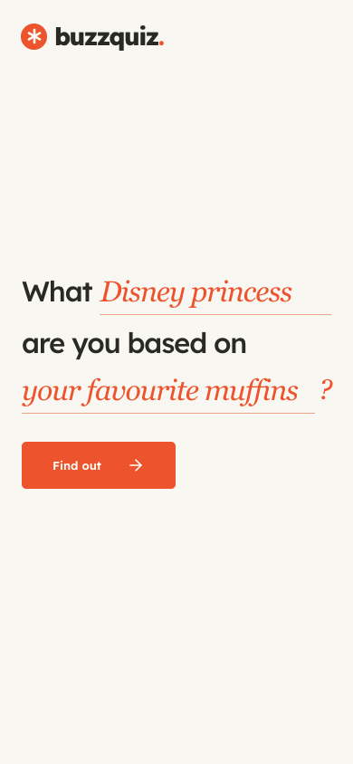
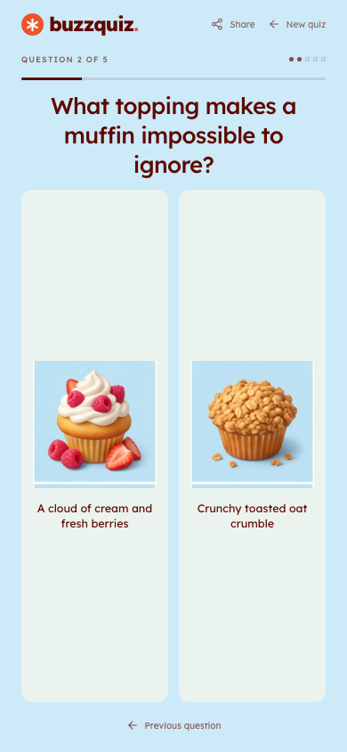

# buzzquiz

**What Disney princess are you based on your favourite muffins?**

Two blanks. Five questions. A personality reveal that's a little too specific.

[Take a quiz](https://buzzquiz.ryankuah.com) · [How it works](docs/architecture.md) · [Run it yourself](docs/development.md)

Buzzquiz brings back the joy of internet personality quizzes. Pick what you want to discover about yourself and what the questions should be about, then jump straight in. No account, quiz editor, or setup screens.

## Pick your own rabbit hole

- **Disney princess × favourite muffins.** A royal verdict from your bakery order.
- **Harry Potter house × morning routine.** A different kind of sorting ceremony.
- **Mythical creature × dream holiday.** Your imagination gets a personality test.

Questions switch between illustrated cards, picture grids, and answer lists, with two or four choices. The result brings together a foreground inspired by your outcome and a background inspired by your quiz theme. Read the character introduction, then get a personal take on your actual answers.

**Send it to a friend.** Share a short quiz link so someone else can take the same quiz and discover their own result.

## Built to reuse

The two blanks work independently. A Disney princess outcome set can appear in many quizzes, and a muffin question set can be paired with many subjects. Introductions, artwork, and completed quizzes are saved in Convex. Personal readings are cached by quiz and exact answer combination.

Saved combinations and shared quizzes open without generating questions or images again. New generation is limited to **five attempts per day across the app**, including personal readings. Failed attempts count; replaying cached content doesn't. This limits generation requests, rather than guaranteeing a fixed dollar spend.

## The stack

Next.js · React · TypeScript · Convex database and file storage · OpenRouter · Vercel

The mobile templates are adapted from [VisionVerse](https://github.com/ryankuah/vision-verse). Buzzquiz is an independent fan project and is not affiliated with BuzzFeed, Disney, or the Harry Potter franchise.

## Development

```sh
npm install
cp .env.example .env.local
npx convex dev
npm run dev
```

Configure your Convex server secret and AI provider key before generating new content. See [development and deployment](docs/development.md) for the complete setup, test commands, migration, and spending controls.

## A look inside

<p>
  
  
  
</p>
